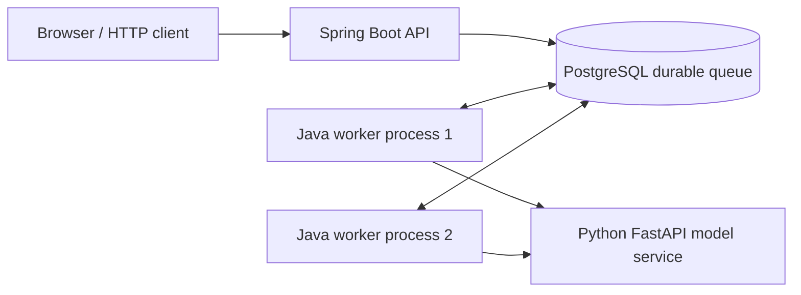

# Nexus — durable task execution and ML inference

Nexus is a single-workspace, self-hosted asynchronous job service. It supports multiple independent Java workers, a PostgreSQL-backed queue, scheduled jobs, priority ordering, lease recovery, retries, cancellation, a monitoring console, and CPU-only ML digit inference. It is designed to show systems engineering decisions rather than collect technology buzzwords.

**Verified baseline:** [CI run 45363232562](https://github.com/ShreyasLohiaFR/Nexus-Distributed-Task-Execution-ML-Inference-Platform/actions/runs/45363232562) passed Java/PostgreSQL integration tests, ML tests, Docker smoke, worker SIGKILL recovery and two 200-job benchmarks. See [verification evidence](docs/verification.md). The release candidate adds continuous worker consumption, dashboard submission protection, a real browser integration test and larger benchmarks. Consult the latest CI before treating those improvements as verified. No public backend deployment has been made.

## Architecture



The API and workers share the same source code but run independently. The dashboard uses plain HTML/CSS/JavaScript (no extra frontend build required); it intentionally avoids a second MERN-style frontend stack. See [design decisions](docs/design.md) and [study guide](docs/STUDY_GUIDE.md).

## Run locally with Docker Compose

Requires Docker Engine/Desktop with Compose v2. Run in a trusted local development environment. Only the API is published, bound to localhost.

1. Copy `.env.example` to `.env`. Generate **two different random secrets** (e.g. `python -c "import secrets; print(secrets.token_urlsafe(32))"` twice), and put them in `DATABASE_PASSWORD` and `NEXUS_API_KEY`.
2. Run `docker compose up --build -d` and check `docker compose ps` / `docker compose logs -f`.
3. Open `http://localhost:8080` and enter the API key. Submit a job and observe the worker complete it.
4. Scale independent worker processes with `docker compose up -d --scale worker=4`. `WORKER_CONCURRENCY` controls threads per worker (default 2); `WORKER_IDLE_POLL_MS` controls empty-queue polling (default 100 ms).
5. Stop using `docker compose down`; the database volume remains. `docker compose down -v` **deletes local jobs**.

### REST endpoints

All `/api/*` endpoints require `X-API-Key`. The application protects all routes by default except exact dashboard assets and read-only health. Health check `/actuator/health` is public locally; `/actuator/prometheus` requires the same key. The API uses UUIDs and accepts optional `Idempotency-Key` (same key + same request returns the existing job; reuse with a different request returns 409).

| Method | Endpoint | Purpose |
|---|---|---|
| POST | `/api/jobs` | Submit one supported job |
| GET | `/api/jobs?state=QUEUED&limit=50` | Inspect recent or filtered jobs |
| GET | `/api/jobs/{id}` | Read status, result and attempt count |
| POST | `/api/jobs/{id}/cancel` | Cancel a non-terminal job |
| GET | `/api/stats` | Count jobs per state |

Example Bash request (set `NEXUS_API_KEY` in your shell):

```bash
curl -X POST http://localhost:8080/api/jobs \
  -H "X-API-Key: $NEXUS_API_KEY" -H 'Content-Type: application/json' \
  -H 'Idempotency-Key: first-demo' \
  -d '{"kind":"WORD_COUNT","payload":{"text":"hello distributed world"},"priority":5,"maxAttempts":3,"delaySeconds":0}'
```

Job types: `WORD_COUNT` and `SHA256` accept `{"text":"..."}` (max 20,000 characters); `DIGIT_CLASSIFY` accepts `{"pixels":[64 finite numbers between 0 and 16]}`. Priority 0–9, max attempts 1–5, delay 0–86400 seconds. Failed terminal jobs are the dead-letter view. No arbitrary code execution.

### Verify the service

```bash
# Maven + a dedicated PostgreSQL test DB (never run against your live jobs)
mvn verify
# Local ML and core logic verification
python -m pip install -r ml/requirements.txt pytest httpx
python -m pytest -q tests/test_ml.py
python -m ml.model
# With Compose running and API key exported
python scripts/smoke.py
python scripts/benchmark.py --jobs 100 --clients 8 --workers-label '1 process x 2 threads'
```

The Maven suite refuses to delete jobs unless the configured database is named `nexus_test`. Use a disposable database. GitHub Actions supplies a dedicated `nexus_test` database. It does not automatically deploy or provision paid services. See [verification plan](docs/verification.md) for concurrency and crash recovery exercises.

## Measured ML experiment

On the installed Python/scikit-learn environment, a deterministic stratified 75/25 split of 1,797 handwritten digit samples produced **97.78% held-out accuracy**, **97.76% macro-F1**, and **10.22% majority-class baseline accuracy** (450 held-out samples). See [raw report](docs/ml-evaluation.json). This is a simple baseline model for the built-in digits dataset, not a claim of general handwriting accuracy or novel research. The dashboard's hand-drawn binary grid has a distribution shift from the grayscale training set.

## Known limits and security

At-least-once execution; lease fencing protects committed state, not exactly-once external side effects. Cancellation invalidates the lease rather than killing arbitrary work. Bounded, pure tasks only. A workspace key is not multi-tenant auth. Strict priorities may starve lower-priority jobs. Polling is used instead of WebSockets to keep the implementation focused. No rate-limiting, TLS termination, retention, backup/restore, dependency audit, external load validation, or cloud hardening has been completed. Job submissions require a known Content-Length of at most 128 KiB. The dashboard uses same-origin requests; API responses are not cached and browser security headers are enabled. Reverse-proxy limits and rate limiting are still required before public exposure. Do not expose the development stack publicly until those limitations are addressed.

## Repository and learning

Development is AI-assisted, with genuine implementation milestone commits. Read and run the project yourself before representing it in applications. No fake benchmarks or backdated contribution history. [Study guide](docs/STUDY_GUIDE.md) explains what to learn and what to implement independently.
